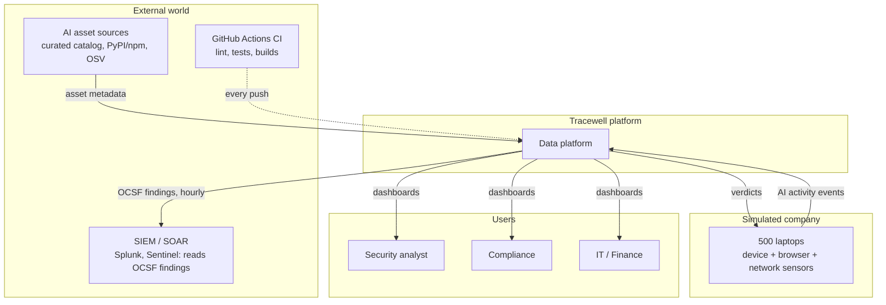
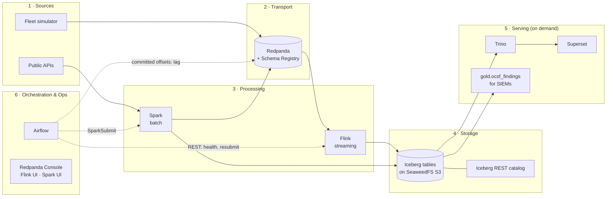
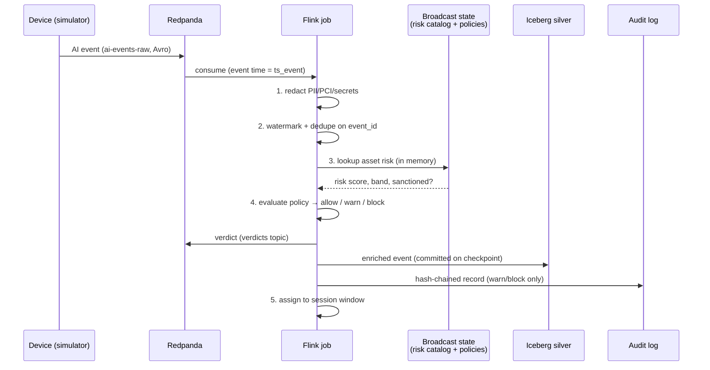
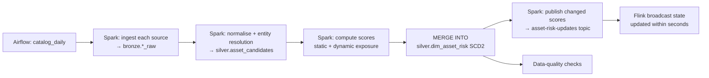
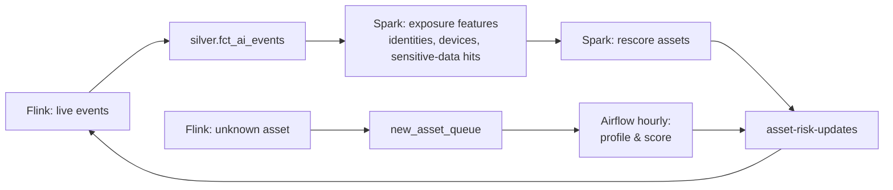
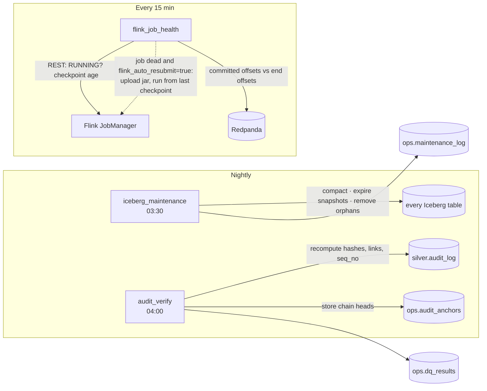

# 02 – Architecture

## 1. Architecture at a glance

Tracewell follows a **Kappa-style streaming core with a batch intelligence layer**, and both share an **Iceberg lakehouse**.

```
 ┌──────────────── BATCH  (Airflow DAG: catalog_daily → SparkSubmit) ─────────────────┐
 │ Curated catalog (CSV)─┐                                                             │
 │ PyPI / npm metadata   ┼─► Iceberg bronze ─► Spark: entity ─► Spark: risk scoring  ─► │
 │ OSV.dev advisories   ─┘   (raw JSON)        resolution       (static + dynamic      │
 │                                             → dim_asset       exposure from silver) │
 │                                                                      │              │
 │                         Iceberg: dim_asset_risk (SCD Type 2 via MERGE INTO)         │
 └──────────────────────────────────────────────────────────────┬──────────────────────┘
                     Spark publishes changed scores ───────────┐ │
                                                               ▼ │
 ┌──────────────────────────── STREAMING (Apache Flink) ─────────┼──────────────────────┐
 │ Fleet simulator ──► Redpanda topic      ┌─ Redpanda compacted topic                  │
 │ (500 devices,       ai-events-raw       │  asset-risk-updates → BROADCAST STATE      │
 │  device/browser/    (Avro, Schema       ▼                                            │
 │  network sensors,   Registry) ──► Flink job:                                         │
 │  offline bursts,                  1. PII/PCI redaction (regex + Luhn)                │
 │  dupes, late data)                2. event-time watermarks + dedupe (keyed state+TTL)│
 │                                   3. enrich with asset risk (broadcast join)         │
 │                                   4. policy verdict allow / warn / block             │
 │                                   5. session windows per identity+device             │
 │                                   6. very-late events → side output topic            │
 │                                   7. warn/block → SHA-256 hash chains (audit)        │
 └───────────────┬──────────────────────────────┬────────────────────────┬──────────────┘
                 ▼                              ▼                        ▼
   Iceberg silver (Flink Iceberg sink,   Iceberg silver.audit_log   Redpanda `verdicts`
   exactly-once via checkpoints):        (4 hash chains)            (exactly-once, back
   fct_ai_events, fct_sessions                  │                    to the device)
                 │                              │
                 ▼                              ▼
   Airflow gold_marts (hourly) → Spark: 7 gold marts incl. ocsf_findings, dq_gold
   Airflow nightly → iceberg_maintenance (compact, expire, orphans) · audit_verify (recompute chains)
   Airflow every 15 min → flink_job_health (Flink REST + Kafka lag; optional resubmit)
                 │
                 ▼
   Trino (on demand) ─┬─► Superset dashboards (shadow AI, fleet risk, AI ROI, investigation, pipeline health)
                      └─► SIEM reads gold.ocsf_findings (OCSF Detection Findings, hourly)
```

## 2. System context



## 3. Layers and components



| Layer | Component | Responsibility |
|---|---|---|
| Sources | **Fleet simulator** (Python) | Produces realistic AI events from 500 devices: normal behaviour, attack scenarios, offline bursts, duplicates, clock skew |
| Sources | **Curated seed + public APIs** | Curated catalog of AI services, agents, extensions, MCP servers and local models (CSV in git); AI packages discovered on npm (keyword searches, ranked by npm's score) and PyPI (AI-named projects from the simple index, most active first); OSV.dev advisories |
| Transport | **Redpanda** | A durable, ordered event log that speaks the Kafka API. Its Schema Registry enforces Avro contracts. |
| Processing | **Apache Flink** | Stateful real-time processing: redaction, dedupe, enrichment, policy, sessionization, exactly-once sinks |
| Processing | **Apache Spark** | Batch ingestion, entity resolution, scoring, SCD2 merges, gold marts, investigations, table maintenance |
| Storage | **Apache Iceberg on SeaweedFS (S3)** | ACID tables shared by Flink and Spark, with time travel, schema evolution and hidden partitioning |
| Storage | **Iceberg REST catalog** (pointers in PostgreSQL) | The single catalog Spark, Flink and Trino use, so table metadata stays consistent. Postgres, not SQLite, because Flink's two committers commit concurrently |
| Serving | **Trino + Superset** | Interactive SQL and dashboards on Iceberg. Started on demand (section 3.1) |
| Serving | **OCSF export** (`gold.ocsf_findings`) | Every warn/block verdict as an OCSF 1.3 Detection Finding, for SIEMs, built hourly like the other marts |
| Orchestration | **Apache Airflow** | Schedules and monitors all batch work: 7 DAGs (catalog, gold marts, late-event backfill, Iceberg maintenance, audit verification, Flink job health, smoke). Talks to Spark (SparkSubmit), to the Flink REST API (health, resubmit; the job jar is mounted read-only) and to Redpanda (consumer-group lag) |
| CI | **GitHub Actions** | On every push: ruff, pytest with Spark in local mode, Flink build + JUnit, compose validation. The full stack is exercised locally by the `tracewell.sh` demos |

### 3.1 Deployment profiles

The 13 containers are grouped into Docker Compose profiles so an 8 GB laptop runs only what it needs ([benchmarks](benchmarks.md#5-memory-8-gb-docker-vm)):

| Profile | Services | Started by | Memory in use |
|---|---|---|---|
| `core` | Redpanda (+ Console), SeaweedFS, PostgreSQL, Iceberg REST catalog, Flink JobManager + TaskManager | `./tracewell.sh up` (always on) | ~2.5 GB |
| `batch` | Spark master + worker, Airflow (and PostgreSQL) | `./tracewell.sh up` (always on) | ~1.3 GB idle, +1–2 GB while a Spark job runs |
| `bi` | Trino, Superset | on demand: the first command that needs them (`dashboards`, `stream-check`, demos), or `up bi` | ~1 GB |
| `stream` | Fleet simulator | `./tracewell.sh simulate` or `up stream` | ~0.1 GB |

`./tracewell.sh up all` starts every profile.

## 4. Data flows

### 4.1 Real-time verdict path (hot path)



### 4.2 Risk intelligence path (batch)



### 4.3 Feedback loop: static plus dynamic scoring



Real-world usage feeds back into the scores. An asset that suddenly starts touching regulated data gets re-scored instead of staying frozen at its original score.

### 4.4 Analytics and investigation path

`silver` tables → Spark SQL (Airflow `gold_marts`, hourly) → `gold` tables → Trino → Superset.
Investigations run as a parameterised Spark job, or as Trino SQL using as-of joins and `FOR TIMESTAMP AS OF`.

### 4.5 Operations path (Phase 5)



A failed `audit_verify` is never retried: an edited row cannot become valid, so it is a critical alert. `flink_job_health` fails its task (the alert) when the job is down, a checkpoint is older than 2 min, or the lag exceeds 50k records.

### 4.6 Export path (OCSF for SIEMs)

`silver.fct_ai_events` (warn/block) → `gold_marts.ocsf_findings` (hourly, rebuilds today and yesterday, idempotent) → `gold.ocsf_findings` (one OCSF Detection Finding per verdict: full event in an `ocsf` JSON column, key fields as columns) → a SIEM reads it through Trino or an export job. Findings therefore arrive in hourly batches; a real-time feed would be a Flink sink writing the same OCSF JSON to a Kafka topic (decision D11).

## 5. Medallion layout in Iceberg

| Layer | Namespace | Written by | Contents |
|---|---|---|---|
| Bronze | `bronze` | Spark (sources), Flink (raw events, already redacted) | Source payloads, raw events |
| Silver | `silver` | Flink + Spark | Clean, deduplicated, enriched facts; asset dimension (SCD2); sessions; audit log |
| Gold | `gold` | Spark | Business marts for dashboards, investigations and the OCSF export |
| Ops | `ops` | Spark | DQ results, entity-resolution metrics, audit anchors, maintenance log, pipeline state |

Even bronze events are **redacted**. Raw prompt text is never written to disk (see [03 – Data Model](03-data-model.md)).

## 6. Key design decisions

| # | Decision | Alternatives considered | Why |
|---|---|---|---|
| D1 | **Redpanda** as the event bus | Apache Kafka, Apache Pulsar | Kafka API compatible (Flink's Kafka connector works unchanged), single binary with no ZooKeeper/KRaft to run, built-in Schema Registry and console, small footprint on a laptop |
| D2 | **Flink** for the real-time path | Spark Structured Streaming | True per-event processing in event time, rich keyed and broadcast state, session windows, side outputs for late data, low latency |
| D3 | **Spark** for batch | Flink batch, Python | Strong at large joins and fuzzy matching; the most complete Iceberg support (`MERGE INTO` and maintenance procedures) |
| D4 | **Iceberg** as the shared table format | Delta Lake, Hudi | Engine-neutral (first-class in Flink, Spark and Trino), hidden partitioning, time travel, safe concurrent writers |
| D5 | **Broadcast state** for catalog enrichment | Lookup per event to a database; Flink lookup join | No network call per event, so lookups are in-memory and fast. Updates arrive as a stream, so no restart is needed. The catalog fits in memory at laptop scale (see the scaling notes) |
| D6 | **SCD Type 2** for asset risk | Overwrite the latest score | Investigations need the score that was valid *at the time of the event* |
| D7 | **Redact inside Flink, before any sink** | Redact later in batch | Raw sensitive text must never touch disk: privacy by design |
| D8 | **Hash-chained audit table** | Plain append-only table | Tampering becomes detectable, which is what audit evidence needs |
| D9 | **Avro + Schema Registry** | JSON | Enforced contracts, compact messages, controlled schema evolution |
| D10 | **Airflow** for orchestration | Cron, Dagster | Industry standard; Spark operators, retries, SLAs, a clear UI |
| D11 | **OCSF findings as a gold Iceberg table** | Flink sink to a Kafka topic | Same idempotent hourly rebuild and DQ checks as every other mart; queryable history (the Amazon Security Lake approach); Spark here cannot write plain files to S3. Cost: findings reach the SIEM hourly, not in real time |
| D12 | **4 audit chains keyed by device** | One global chain | One chain would force the audit operator to parallelism 1; per-device chains keep it parallel while every chain stays gap-free. Verification runs per chain with window functions |
| D13 | **Consumer lag from committed offsets** | Flink `pendingRecords` metric; Redpanda Console API | Both alternatives reported 0 or nothing while the real lag was ~9,000 records; committed vs end offsets is exact (it includes up to one checkpoint of records) |
| D14 | **BI services on demand** | Everything always on | All memory limits add up to ~14.7 GB on an 8 GB VM; Trino and Superset are only needed for queries and dashboards |

## 7. Reliability and correctness

| Concern | Mechanism |
|---|---|
| Duplicate events | Flink keyed `ValueState` on `event_id` with a 48h TTL |
| Late events | Event-time watermarks (5 min out-of-orderness). Every event, however late, is still enriched, judged and written to silver. Only the session windows care: an event that arrives after its window fired goes to the `late-events` side output, and the hourly Spark `late_event_backfill` re-sessionizes that device from silver and swaps the repaired sessions in with one atomic MERGE. Verified: a laptop flushing 12 h of activity produced exactly the 4 expected sessions |
| Crash recovery | Flink checkpoints every 20 s (RocksDB, incremental), retained on cancel; `submit-flink` (or `flink_job_health` with auto-resubmit) resumes from the newest one. Redpanda offsets and the Iceberg commit are part of each checkpoint, which gives exactly-once. **Verified by `demo-crash`**: TaskManager killed mid-stream, 6,825 records sent = 6,825 bronze rows, 6,749 distinct = 6,749 silver rows = 6,749 committed verdicts. Long-running containers use `restart: unless-stopped`. |
| Job health | `flink_job_health` every 15 min: job RUNNING, checkpoint < 2 min old, lag < 50k |
| Evidence integrity | Audit chain state is checkpointed with the Iceberg commit, so a crash cannot fork or gap a chain; `audit_verify` nightly (**`demo-tamper`** detects an edited row) |
| Concurrent writes | Iceberg optimistic concurrency. Flink and Spark write *different* tables, with one exception: `fct_sessions`, where Flink appends and the Spark backfill MERGEs; the table uses snapshot isolation so the MERGE commits next to the appends. Spark compaction rewrites Flink's files without changing rows. |
| Small files from streaming | Hourly compaction of the last two days (`gold_marts`) and the nightly `iceberg_maintenance`: full compaction (measured −94% files), `expire_snapshots` by table retention, `remove_orphan_files` |
| Schema changes | Avro backward-compatible evolution; Iceberg column adds without rewriting data. **Verified by `demo-schema`**: a new field under the running job, 0 restarts, 0 dead-letter records |
| Bad data | Malformed records go to a dead-letter topic `ai-events-dlq` |

## 8. Security and privacy

- **Redaction rules:** card numbers (regex + Luhn), emails, phone numbers, Indian PAN/Aadhaar patterns, API keys/tokens (known prefixes plus an entropy check), IBAN. Matches become `[REDACTED:PCI]` etc., and only *counts per entity type* are kept.
- **Least data:** prompt text is truncated to 500 characters after redaction; file contents are never captured (only name, extension, size and a sensitivity label).
- **Tamper evidence:** `audit_log.record_hash = SHA256(prev_hash ‖ canonical record)` in 4 chains; verified nightly, with chain heads anchored so truncation is caught too ([04, H.1](04-pipelines.md#h1-tamper-evident-audit-log)).
- **Secrets:** passwords and keys live in a `.env` file excluded from git and are passed to containers as environment variables. The catalog's public APIs (PyPI, npm, OSV) need no tokens.

## 9. Scalability notes (beyond the laptop)

| Today (laptop) | At production scale |
|---|---|
| Catalog of about 10k–50k assets in broadcast state | 1M+ assets: keyed state on RocksDB partitioned by `asset_id`, or an external KV store with async I/O and a cache |
| 1 Flink TaskManager, a few hundred events/s | Scale out by partitioning on `device_id`; more Redpanda partitions |
| Single SeaweedFS node | S3 / GCS / ADLS |
| Iceberg REST catalog in a container | Managed catalog (AWS Glue, Polaris, Nessie) |
| Airflow LocalExecutor | Celery/Kubernetes executor |
| 4 audit chains | More chains (by device bucket); anchor heads to an external write-once store (S3 Object Lock) |
| ~300–400 events/s before the job falls behind ([benchmarks](benchmarks.md)) | More slots and parallelism, Iceberg sinks in their own job, a longer checkpoint interval |
