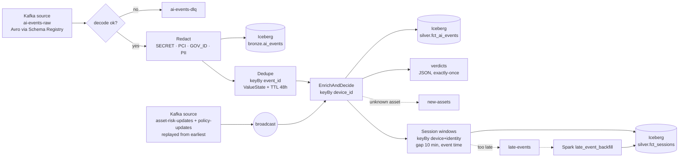
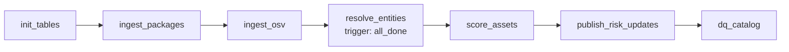
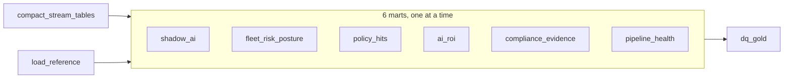
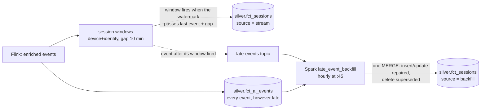

# 04 – Pipelines

This doc covers every job in the platform: what it reads, what it does, what it writes, and how it fails safely.

---

## Part A: Fleet simulator (Python, implemented)

Code: `simulator/` (image `tracewell/simulator`, compose profile `stream`). Run it with `./tracewell.sh simulate [args]`.

**Realistic by construction.** At start-up the simulator reads the live risk catalog from the compacted `asset-risk-updates` topic and "installs" a realistic subset on every laptop: all curated AI services, agents and extensions, all seed packages, 40 models, and 120 MCP servers (30 of them High-risk), chosen by department. Every event therefore refers to a real asset. 40% of references use an alias (package key, lower-case name, repo slug) instead of the canonical id, as a real sensor would report it.

| Setting (flag) | Default |
|---|---|
| Devices / people (`--devices`, `--people`) | 500 / 300, across engineering, finance, sales, hr, support, legal |
| Rate (`--rate`) | 50 events/s |
| Offline (`--offline-rate`) | a device can go offline for 1–10 min (scaled-down hours) and then flushes its buffered events with their original `ts_event` |
| Duplicates (`--duplicate-rate`) | 1%: the same event is resent with the same `event_id` |
| Clock skew | ±2 min on about 3% of devices |
| Unknown assets (`--unknown-rate`) | 2% of events reference MCP servers that aren't in the catalog |
| Sensitive data (`--sensitive-rate`) | 4% of prompts and 8% of pastes contain fake emails, phone numbers, Luhn-valid test card numbers, AWS/OpenAI-style keys, or PAN/Aadhaar numbers |

**Scenarios** (`--scenarios`, injected after `--scenario-after` seconds):

| Scenario | What happens | Verdict observed |
|---|---|---|
| `poisoned_package` | 3 engineering laptops install `pypi:chromadb` (open critical advisory) | **block** (P002, Critical) |
| `secret_paste` | A developer pastes an AWS key into Claude Code (unsanctioned) | **block** (P003) |
| `finance_upload` | An analyst uploads `finance_q3.xlsx` to DeepSeek Chat (unsanctioned) | **warn** (P006) |
| `rogue_mcp` | An unknown MCP server appears, reads `customers.csv`, sends 48 MB to an unknown host | **warn** (P007) + reported on `new-assets` |

Output: Confluent-framed Avro on `ai-events-raw` (schema `schemas/ai_event.avsc`, registered as `ai-events-raw-value`), key = `device_id`. A background consumer prints Flink's live verdict counts and every block.

Helpers in the same image: `init_topics.py` (all topics + schema, run by `./tracewell.sh init`) and `publish_policies.py` (`policies/*.yaml` → compacted `policy-updates`, with tombstones for removed rules).

---

## Part B: Flink streaming job `tracewell-stream` (Java, implemented)

Code: `flink-jobs/tracewell-stream/` (Maven; `./tracewell.sh build-flink` builds and unit-tests it inside a Maven container, `./tracewell.sh submit-flink` submits it and resumes from the latest checkpoint).

### B.1 Operator graph



### B.2 Steps

| Step | Logic |
|---|---|
| **Decode** | Confluent wire format: the writer schema is fetched from the Schema Registry by id and cached, so producers can evolve the schema without redeploying. Bad records go to `ai-events-dlq` (with the error and raw bytes); the deserializer never throws. |
| **Watermarks** | Bounded out-of-orderness of 5 min on `ts_event`, idleness 1 min. The control stream is marked **permanently idle**, so it never holds back event time after the broadcast join (see B.5: it used to emit the maximum watermark, which froze event time once the events went idle). |
| **Redact** | `Redactor`: ordered regex detectors (secrets, then Luhn-checked card numbers, then PAN/Aadhaar, then emails and phones). Matches become `[REDACTED:<TYPE>]`; only the categories and the count are kept. Runs **before** the first sink. |
| **Bronze sink** | Every redacted copy, duplicates included, so dedupe can be audited. |
| **Dedupe** | Keyed by `event_id`; the first copy passes and resends are dropped (`events_deduped` metric). |
| **Enrich & decide** | Broadcast state holds every asset's current profile, an **alias index** (any reference → `asset_id`) and the policies. Tombstones remove retired assets. Events resolve their `asset_ref`; unknown assets get a provisional High profile and are reported once per device. Policies are evaluated in priority order; the first match wins, default allow. `latency_ms = verdict time − ts_sent`. |
| **Warm-up** | After a fresh start the catalog (about 22k assets) is replayed from the compacted topic. Events arriving before it has loaded are **parked** in keyed state and released by a timer, so they aren't misjudged as "unknown". |
| **Sessions** (Phase 4) | Timestamps are re-assigned from `ts_event` after enrichment (events released from warm-up parking leave a processing-time timer without one), then **event-time session windows** keyed by `device_id|identity` with a 10-min gap (`--session-gap-minutes`; 30 min would be usual, the simulator compresses a working day). The aggregate is incremental and mergeable, so state is one small accumulator per open session. Session id = `sha256(device|identity|first event millis)[:16]`, identical to the Spark backfill's. Events whose window has already fired go to the **`late-events`** side output (JSON with `lateness_ms`). |
| **Audit chain** (Phase 5) | Every warn/block verdict is keyed by `chainOf(device_id)` (4 chains) into `AuditChain`, which keeps `seq_no` and the last hash in keyed state and emits `record_hash = sha256(prev_hash ‖ canonical record)`. The state is checkpointed with the Iceberg commit, so after a crash both roll back together and the chain stays gap-free (H.1). |
| **Sinks** | Iceberg bronze, silver, `fct_sessions` and `audit_log` through the Table API on the same job graph (committed on every checkpoint, exactly-once); `verdicts` through a transactional Kafka sink (exactly-once); `new-assets`, `late-events` and DLQ at-least-once. |

### B.3 Runtime configuration

| Setting | Value |
|---|---|
| Checkpoints | Every 20 s, exactly-once, RocksDB incremental, `s3://checkpoints/flink`, **retained on cancel** |
| Restart | Flink default for checkpointed jobs (exponential delay) |
| Parallelism | 2 (laptop); TaskManager 1.5 GB process memory, 4 slots |
| Packaging | The Kafka connector, Avro and Jackson are bundled in the job jar; Flink runtime, Table API and Iceberg come from the cluster |

### B.4 Measured results (26 Oct 2026, 50 events/s, laptop)

| What | Result |
|---|---|
| Latency, device send → verdict | **p50 130 ms · p95 229 ms · p99 710 ms** · max 1.6 s |
| Catalog change → verdicts change, no restart | **3.7 s** from the update landing in Redpanda to the first verdict on the new profile (includes waiting for the next event about that asset); 0 old-profile verdicts afterwards |
| Dedupe | 0 duplicate `event_id`s in silver |
| Privacy | 0 raw secrets, cards, emails, phones or government IDs in bronze or silver |
| Enrichment | 98.4% of events resolved; the 1.6% unknown matches the planned unknown rate |
| Exactly-once under failure | Topic: 57,313 records → bronze: 57,313 rows; silver: 56,803 = distinct events, 0 duplicates. This survived ~20 failed catalog commits, a catalog migration, a storage OOM crash and a resume from checkpoint |

### B.5 What broke on the way (and the fix)

| Problem | Cause | Fix |
|---|---|---|
| Job failed: `NoSuchMethodError` in Jackson | Avro pulled an older `jackson-core` than `jackson-databind` needs (Maven nearest-wins) | Import `jackson-bom` in `dependencyManagement` |
| `SQL parse failed. Encountered "identity"` | `identity` is a reserved word in Flink SQL | Quote it with backticks |
| Iceberg commits failed with HTTP 500 | The REST catalog stored pointers in **SQLite**; the bronze and silver committers commit at the same moment on every checkpoint (`SQLITE_BUSY`, then `SQLITE_BUSY_SNAPSHOT` with WAL) | Catalog moved to **PostgreSQL** (custom `tracewell/iceberg-rest` image with the JDBC driver); existing table pointers migrated row by row; the SQLite file kept as a backup |
| Catalog requests hung; Spark publish hung | **SeaweedFS was OOM-killed** (400 MB) under checkpoints + commits + a Spark job at once | SeaweedFS 1 GB; `restart: unless-stopped` on all long-running services; Kafka AdminClient timeouts in the publisher |
| Job lost when the JobManager container was recreated | No HA; checkpoints are only kept on failure | `RETAIN_ON_CANCELLATION` and `./tracewell.sh submit-flink` resumes from the newest checkpoint that has `_metadata` |
| Phase 4: 11k of 15k fresh events went to `late-events` (lateness ≈ 0 s) | While no events flowed, the enrichment operator's watermark became the control stream's `Long.MAX_VALUE`; `assignTimestampsAndWatermarks` forwards that "end of time" watermark and watermarks never go back, so every later event was late for the session windows | The control source is marked permanently idle instead (excluded from the watermark minimum); the backfill repaired the affected sessions |
| Adding the sessions sink: `Cannot map checkpoint/savepoint state for operator …` | Table API operators get auto-generated uids, which change when a sink is added | `./tracewell.sh submit-flink --allow-non-restored`, only with the stream quiet so no commit is pending |
| Shaded `flink-sql-connector-kafka` in the cluster | It relocates Kafka classes, so DataStream code can't read record keys (needed for tombstones) | Removed from the image; the connector is bundled in the job jar |

---

## Part C: Spark batch jobs (Phase 1: risk catalog, implemented)

Code lives in `spark-jobs/catalog/`. Every job runs with `spark-submit` against the Iceberg REST catalog, from Airflow or by hand. HTTP calls run on the driver with a thread pool; all transformation logic is Spark column expressions in `transforms.py`.

| Job | Reads | Writes | What it does |
|---|---|---|---|
| `init_tables.py` | – | all `bronze`/`silver`/`ops` tables | Idempotent DDL |
| `ingest_packages.py` | npm search API, PyPI simple index + JSON API | `bronze.pkg_metadata_raw` | Seed packages and those curated MCP servers declare, plus **discovery**: the top ~12,000 npm packages from 17 AI keyword searches (one request returns 250 packages with their metadata) and ~8,000 AI-named PyPI projects, most recently active first; skips packages fetched in the last 7 days; bronze commit every 1,000 fetches |
| `ingest_osv.py` | OSV `querybatch` + `vulns/{id}` | `bronze.osv_advisories_raw` | Advisories affecting **the version in use** of each package (re-queried daily); details fetched once per vulnerability id |
| `resolve_entities.py` | bronze + curated catalog | `silver.asset_candidates`, `silver.asset_entity_map`, `ops.entity_resolution_metrics` | Normalise each source, enrich packages with OSV, resolve entities (C.1) |
| `score_assets.py` | candidates + entity map + seeds | `silver.dim_asset_risk` | Aggregate per asset, Tracewell risk score ([05](05-risk-scoring.md)), hybrid SCD1/SCD2 `MERGE` (C.2) |
| `publish_risk_updates.py` | `dim_asset_risk` | Redpanda `asset-risk-updates` | New versions since the last watermark → Avro in Confluent wire format, key = `asset_id`; **tombstones** (null value) for retired assets; creates the compacted topic if missing; registers the schema |
| `dq_catalog.py` | silver, bronze | `ops.dq_results` | 13 checks; fatal failures fail the task (C.4) |

**Curated catalog:** `seed/curated_assets.csv` lists the AI services, coding agents, browser extensions, MCP servers and local models the company cares about, with publisher, licence, curated capability tags and an exposure prior. MCP servers also name their GitHub repo and the npm/PyPI packages that ship them, and models their task (`pipeline_tag`). It replaces the earlier bulk ingestion from Hugging Face, the MCP Registry and GitHub: the tools that matter most are reviewed by hand, and breadth comes from package discovery instead (below).

**Bronze design:** every bronze table has the same generic schema (`run_id, source, record_key, payload JSON, fetched_at, ingested_at`), is append-only, and is partitioned by `days(ingested_at)`. Readers take the latest record per `(source, record_key)`. Re-ingesting is always safe, and full history is kept.

### C.1 Entity resolution
1. **Normalise:** `norm_name()` lowercases, drops the scope or reverse-DNS namespace (`@scope/`, `io.github.owner/`), strips MCP affixes (`mcp-server-`, `server-`, `-mcp`, `-mcp-server`) and keeps `[a-z0-9]`. Repo URLs of any form (`git+https`, `git@github.com:`, `/tree/main/...`) become `owner/repo`. PyPI names follow PEP 503.
2. **Link rules** (MCP servers ↔ npm/PyPI packages):
   - `declared_package`: the curated entry lists the package identifier. This is ground truth.
   - `shared_repo`: same GitHub repo (from the curated entry and from the package's npm/PyPI metadata), with a **monorepo guard**. It only applies when the repo hosts exactly one MCP server and at most one package per ecosystem. `modelcontextprotocol/servers` hosts many servers and must never merge them.
   - `fuzzy_name`: Levenshtein similarity ≥ 0.9 on normalised names (≥ 4 chars), blocked by the first 3 characters, only when the name is **unique on both sides**, **and** the link is plausible: the package is an MCP package (its name contains "mcp") or shares a publisher or repo owner with the server.
3. **One server per package:** each package keeps only its best edge (declared > shared repo > fuzzy). Every edge joins one MCP server to one package, so this guarantees no component ever contains two MCP servers.
4. **Connected components** by label propagation in Spark. Each node takes the smallest label among itself and its neighbours; labels are prefixed by priority (MCP server < package), so the canonical asset is the MCP server.
5. **Evaluation:** the heuristic rules (2 + 3) are scored against rule 1 as ground truth, for MCP servers that declare packages. Results go to `ops.entity_resolution_metrics`.

**Current build (28 Oct 2026):** 20,023 candidates (12,012 npm, 7,963 PyPI, 48 curated) → **20,011 assets**: 10 packages merged into their curated MCP server by `declared_package` and 2 by `shared_repo`. Heuristics vs declared links: **precision 1.0, recall 0.3** (3 TP, 0 FP, 7 FN). Recall fell from 0.9 on the 88-asset catalog because discovery adds packages that share the same repos and names, so the monorepo guard and the unique-name rule hold back more links. The guards trade recall for precision on purpose: a missed link leaves two assets, a wrong one merges unrelated tools.

**What real data taught us.** These bugs were found while the catalog still ingested the full public MCP Registry (25,266 candidates → 22,063 assets, heuristics precision 0.999 / recall 0.77 against declared links). Each was fixed and is still covered by a unit test or DQ check:

| Problem found | Example | Fix |
|---|---|---|
| Monorepos | `modelcontextprotocol/servers` hosts dozens of servers | Shared-repo guard (`test_monorepo_guard_blocks_shared_repo`) |
| Similar names are not the same thing | Picsart's `gen-ai` MCP server merged with Google's `@google/genai` SDK | Plausibility guard on fuzzy matches (`test_fuzzy_needs_more_than_a_similar_name`) |
| Transitive chaining | Server A declares a package that server B fuzzy-matched, so A and B became one asset | One-server-per-package pruning (`test_each_package_attaches_to_one_server`) plus DQ check `max_one_mcp_server_per_asset` |
| Assets that disappear | A package merged into a server kept its old row marked current | `WHEN NOT MATCHED BY SOURCE` retires it; Redpanda gets a **tombstone**; DQ check `current_assets_match_resolution` |

The precision metric did **not** catch the `gen-ai` false merge, because it only judges servers that declare packages. A metric only covers the cases it can see, so spot-checking merged clusters by hand is still needed.

### C.2 SCD Type 2 merge (hybrid with Type 1)
- **Type 2 (new version):** a `row_hash` over the scored attributes (capability, exposure, governance, score, band, sanctioned, licence, reasons). When it changes, the current row is closed (`valid_to = run time`) and a new row is inserted.
- **Type 1 (in place):** name, description, version, popularity, aliases and sources are updated on the current row when they change. A download count going up is not a risk event.

```sql
MERGE INTO tracewell.silver.dim_asset_risk t
USING (
  SELECT s.asset_id AS merge_key, s.* FROM staged s
  UNION ALL
  SELECT NULL AS merge_key, s.* FROM staged s            -- second copy of changed rows = new version
  JOIN tracewell.silver.dim_asset_risk c ON c.asset_id = s.asset_id AND c.is_current AND c.row_hash <> s.row_hash
) s
ON t.asset_id = s.merge_key AND t.is_current
WHEN MATCHED AND t.row_hash <> s.row_hash THEN UPDATE SET t.valid_to = s.valid_from, t.is_current = false
WHEN MATCHED AND (NOT (t.popularity <=> s.popularity) OR ...) THEN UPDATE SET t.popularity = s.popularity, ...
WHEN NOT MATCHED THEN INSERT *
WHEN NOT MATCHED BY SOURCE AND t.is_current THEN UPDATE SET t.valid_to = <run time>, t.is_current = false
```

- **Retirement:** current rows for assets that resolution no longer produces are closed (`WHEN NOT MATCHED BY SOURCE AND t.is_current`). If the asset reappears later, it gets a new version after a gap.

Verified: the first run inserted 10,058 versions; a re-score after recalibration closed and re-inserted 10,008; an unchanged re-run inserted **0** and closed **0**; a wrongly merged package was retired and then revived as its own asset once the fuzzy rule was fixed.

### C.3 Point-in-time investigation (Phase 4, implemented)
`spark-jobs/investigate/investigate.py` (`./tracewell.sh investigate --session <id>` or `--event <id>`): see [Part G](#part-g-sessions-late-events-and-investigation-phase-4-implemented). The core is an as-of join, cross-checked against Iceberg time travel:

```sql
-- SCD2 as-of: the version valid when the event happened
SELECT e.ts_event, e.asset_id, e.risk_score_at_event AS score_enforced, r.risk_score AS score_asof, cur.risk_score AS score_today
FROM tracewell.silver.fct_ai_events e
JOIN tracewell.silver.dim_asset_risk r   ON r.asset_id = e.asset_id AND e.ts_event >= r.valid_from AND e.ts_event < r.valid_to
JOIN tracewell.silver.dim_asset_risk cur ON cur.asset_id = e.asset_id AND cur.is_current
WHERE e.device_id = :device AND e.identity = :identity AND e.ts_event BETWEEN :session_start AND :session_end;

-- Time travel: the table exactly as it was committed at the event's time
SELECT * FROM tracewell.silver.dim_asset_risk FOR TIMESTAMP AS OF :ts_event WHERE asset_id = :asset_id AND is_current;
```

### C.4 Catalog data-quality checks (`dq_catalog.py`)
Fatal: ≥ 15,000 current assets (`CATALOG_MIN_ASSETS`) · exactly one current version per asset · no overlapping SCD2 versions · scores within 0–10 · band matches score · every candidate mapped to an asset · at most one MCP server per asset · current assets = resolved assets · catalog built within 26 h.
Warning / info: every score has at least one reason · SCD2 gaps (retired and later reappeared) · each bronze source ingested within 26 h.

---

## Part D: Airflow DAGs

### D.1 `catalog_daily` (implemented)



- Schedule `0 2 * * *`, `max_active_runs=1`; each Spark app is capped at 1 core.
- `ingest_packages` fetches the seed packages and those the curated MCP servers declare; OSV checks the versions it found, hence the order.
- `resolve_entities` uses `trigger_rule=all_done`. If one API is down, bronze still holds that source's last good data, so the catalog is still built and the DQ bronze-freshness warning flags the stale source.
- Retries: 2 with exponential backoff (none for `dq_catalog`: a failed check must not be retried away). Timeout 1 h per task.
- Every task is a `SparkSubmitOperator` (client mode, driver in the Airflow container) with `common.py` and `transforms.py` shipped as `--py-files`.

Run it once now: `./tracewell.sh catalog`.

### D.2 `gold_marts` (implemented)



- Schedule `15 * * * *` (hourly at :15), `max_active_runs=1`, `max_active_tasks=1` (one Spark app at a time: see F.5), each Spark app capped at 1 core. Run timeout 50 min.
- Retries: 2 with a 1-minute delay (none for `dq_gold`). Each task is a `SparkSubmitOperator` running `spark-jobs/gold/*.py` with `common.py` and `marts.py` as `--py-files`.
- Details and measurements: [Part F](#part-f-gold-marts-phase-3-implemented).

Run it once now: `./tracewell.sh gold`.

### D.3 `late_event_backfill` (implemented)
Hourly at :45 (never overlapping `gold_marts` at :15): one `SparkSubmitOperator` running `spark-jobs/sessions/late_event_backfill.py --hours 48 --gap-minutes 10`. Retries 2. Details: [Part G](#part-g-sessions-late-events-and-investigation-phase-4-implemented).

### D.4 Phase 5 DAGs (implemented)

| DAG | Schedule | Tasks | Failure handling |
|---|---|---|---|
| `iceberg_maintenance` | 03:30 daily | one Spark task over every table: full compaction of the stream tables → expire snapshots by retention → remove orphan files older than 3 days (H.2) | 1 retry; per-table results in `ops.maintenance_log` |
| `audit_verify` | 04:00 daily | `verify_audit_chain` (H.1) | No retries: a failure means the evidence changed, a **critical alert** |
| `flink_job_health` | every 15 min | Flink REST: job RUNNING? newest checkpoint < 2 min old? consumer-group lag on `ai-events-raw` < 50k? (H.3) | Fails the task; with Variable `flink_auto_resubmit=true` it first resubmits the job from the last retained checkpoint |

Still planned: `new_asset_profiling` (hourly: read the new-asset queue → profile → score → publish; unresolvable after 3 tries keeps band High).

---

## Part E: Data-quality checks

| Check | Table | Rule |
|---|---|---|
| No raw PII | `silver.fct_ai_events`, `bronze.ai_events` | 0 rows match card/email/key regexes in `prompt_text` |
| Catalog freshness | `dim_asset_risk` | max(`valid_from`) within the last 26 h |
| Single current version | `dim_asset_risk` | exactly 1 `is_current` row per `asset_id` |
| SCD continuity | `dim_asset_risk` | no gaps or overlaps between versions |
| Referential integrity | `fct_ai_events` | ≥ 98% of events have a resolved `asset_id` |
| Completeness | `fct_ai_events` vs Redpanda | row count ≈ topic offset delta minus dedupes and DLQ |
| Score range | `dim_asset_risk` | all scores between 0 and 10, band consistent with score |
| Audit chain intact | `silver.audit_log` | every hash, link and `seq_no` recomputes; anchored heads still present (`audit_verify`) |
| OCSF well-formed | `gold.ocsf_findings` | class 2004, severity 2–5, time, finding uid and OCSF version present; one finding per event |

Implemented as Spark assertions inside Airflow tasks (Great Expectations or Soda optional).

---

## Part F: Gold marts (Phase 3, implemented)

Code: [`spark-jobs/gold/`](../spark-jobs/gold/) (marts are pure DataFrame functions in `marts.py`, unit-tested in `tests/gold/`), DAG [`airflow/dags/gold_marts.py`](../airflow/dags/gold_marts.py), dashboards as code in [`dashboards/build_dashboards.py`](../dashboards/build_dashboards.py). Table columns: [03 §3.3](03-data-model.md#33-gold).

### F.1 Jobs

| Script / task | Reads | Writes | What it does |
|---|---|---|---|
| `compact_stream_tables.py` | `silver.fct_ai_events`, `bronze.ai_events` | same tables | `rewrite_data_files` on the last 2 days: merges the ~13 KB files Flink's 20 s commits leave behind (one afternoon: **3,325 files → 144**; an hour of traffic: 272 → 16). Safe next to Flink: rewrites files, not rows, and commits optimistically |
| `build_gold.py --mart reference` | `seed/*.csv` | `silver.dim_licence`, `dim_identity`, `dim_device` | Atomic `createOrReplace` of the reference tables |
| `build_gold.py --mart <mart>` | silver + reference | `gold.<mart>` | Rebuilds whole UTC days (`--days 2`: today and yesterday; months for `ai_roi`) and **overwrites only those partitions** (`overwritePartitions`), so reruns are idempotent and late events land in the next run. A column added to a mart is added to the table first (`ALTER TABLE … ADD COLUMN`, Iceberg schema evolution) |
| `dq_gold.py` | gold + silver | `ops.dq_results` (suite `gold`) | 17 checks (F.3); a fatal failure fails the task |

### F.2 What each mart answers

| Mart | Question | Notes |
|---|---|---|
| `shadow_ai` | Which AI is in use that nobody approved, and could a network-only tool even see it? | Unsanctioned **or unknown** assets; `seen_only_on_device` = no network-sensor event that day; `mb_out` and `files_touched` make exfiltration stand out (the rogue MCP: 48 MB, `customers.csv`) |
| `fleet_risk_posture` | How risky is the AI each department actually uses? | Each asset counted once at its worst band of the day, so averages are per asset, not per event |
| `policy_hits` | What did the policies block or warn on, and why? | Policy names come from `policies/*.yaml`, the same rules Flink enforces |
| `ai_roi` | Are we paying for seats nobody uses, or for two tools that do the same job? | Active users are counted against the HR directory only; `users_without_seat` shows demand beyond what was bought |
| `compliance_evidence` | Which framework controls apply to each asset, and on what evidence? | Crosswalk in [05 §6](05-risk-scoring.md#6-framework-crosswalk-for-goldcompliance_evidence); all 22,063 current assets, flagged `in_use_30d` |
| `pipeline_health` | Is the real-time path healthy, hour by hour? | Hours with no traffic get a row with 0 events, so an outage is visible rather than skipped |

### F.3 Gold data-quality checks (`dq_gold.py`)
Fatal: posture reconciles with silver (for each day, the mart's event count lies between the silver rows processed 2 min before the build and those processed by the build: Flink commits every 20 s, so this is exact without a race) · unique keys in all six marts · ROI seat arithmetic (`idle + active − without_seat = seats`) · compliance covers every current asset · every High/Critical asset in use has at least one mapped control · every shadow-AI row is backed by an unsanctioned or unknown event · no raw PII in silver for the window.
Warning (SLOs from [06 §6](06-setup-and-operations.md#6-monitoring)): worst hourly p95 latency < 1 s · late < 5% · unknown assets < 2% · DLQ < 0.1% · stream processed an event within 15 min.

### F.4 Dashboards (Superset, built by `./tracewell.sh dashboards`)

The Trino connection, 11 datasets (4 physical tables + 7 SQL views for "latest day/month" and unnesting arrays), 35 charts and 4 dashboards are created through the Superset REST API and matched by name, so rerunning updates them in place. Superset queries Trino live (no cache), so each hourly DAG run is visible on the next refresh (dashboards auto-refresh every 10 min).

| Dashboard | URL | Shows |
|---|---|---|
| Shadow AI | http://localhost:8089/superset/dashboard/shadow-ai/ | KPIs (shadow assets, new today, % seen only on the endpoint, unknown to the catalog), by category × band, visibility, AI the catalog has never seen, most widespread shadow AI |
| Fleet Risk Posture | http://localhost:8089/superset/dashboard/risk-posture/ | High-risk share, blocks, warns, sensitive events; assets by band per department; verdicts per department; policy hits by rule and the newest hits; mean/max risk score; in-use assets per OWASP LLM risk; compliance evidence table |
| AI ROI | http://localhost:8089/superset/dashboard/ai-roi/ | Spend, idle seat cost, utilisation, overlaps; utilisation by tool × department; idle cost by tool; licences vs usage |
| Pipeline Health | http://localhost:8089/superset/dashboard/pipeline-health/ | Latency p95, throughput, late %, unknown % (with trend lines); latency percentiles (log scale); throughput; lateness/unknown/DLQ; latest `dq_gold` results |

### F.5 What broke on the way (and the fix)

| Problem | Cause | Fix |
|---|---|---|
| Each mart took ~4 min for a few hundred rows | Flink's 20 s commits had left 3,325 files of ~13 KB in silver; every job opened all of them | `compact_stream_tables` as the DAG's first task |
| `ValidationException: Deleted manifest … could not be found` | `rewrite_manifests` raced Flink, whose merge-append also rewrites manifests on every commit | Dropped: Flink's merge-append already bounds the manifest count |
| `INSERT_COLUMN_ARITY_MISMATCH` on `shadow_ai` | Two columns were added to the mart after the table existed | Automatic `ADD COLUMN` before writing (schema evolution) |
| Two marts in parallel took ~5.5 min each, one alone ~1.5 min | The 8 GB Docker VM ran out of RAM and swap (memory "full" stall ~40%) with two Spark drivers + executors next to the always-on stack | `max_active_tasks=1` |
| `list >> list` dependency error | Airflow can't set dependencies between two lists | `cross_downstream([compact, reference], marts)` |
| Each simulator run invented a new company (unseeded names: 1,770 "people" for 500 laptops) | Faker was not seeded | Seeded people + an exported HR directory; ROI counts directory people only |

---

## Part G: Sessions, late events and investigation (Phase 4, implemented)

### G.1 How a session is built, and repaired



| Piece | Code | What it does |
|---|---|---|
| Session window | `flink-jobs/.../Sessions.java`, `TracewellStreamJob` | Mergeable incremental aggregate per (device, identity), 10-min gap; emits `session_id, start, end, counts, assets, max band, blocks, warns, MB out`. Late elements → `late-events` |
| Sessionizer | `spark-jobs/sessions/sessionize.py` | The same rule in Spark (`lag` → new session when the pause ≥ gap → running sum), the same `session_id` formula (a shared test vector in JUnit and pytest proves both produce `4df2cccb30098f73`) |
| Backfill | `spark-jobs/sessions/late_event_backfill.py` | Reads 48 h of `late-events`, re-sessionizes those devices from silver (from a day before their earliest late event), keeps sessions that are closed (last event older than gap + 15 min), and MERGEs: new/changed → upsert, overlapping stream sessions with another id → delete. A rerun changes nothing. `--full` = sessionize all of silver |
| Checks | `sql/checks/session_checks.sql` (`./tracewell.sh session-check`) | No overlapping sessions; every settled event in exactly one session; what the backfill repaired |

### G.2 Investigation (`./tracewell.sh investigate --session <id>` or `--event <id>`)

`spark-jobs/investigate/investigate.py` builds, for every event in the session, four views of the asset's risk:

| View | Source | Meaning |
|---|---|---|
| Enforced | `fct_ai_events.*_at_event` | What Flink's broadcast state held when it judged the event |
| SCD2 as-of | `dim_asset_risk`, `valid_from ≤ ts_event < valid_to` | The business-valid version at that moment |
| Time travel | `dim_asset_risk` at the last Iceberg snapshot committed before `ts_event` | The table exactly as anyone could have read it then |
| Today | `dim_asset_risk WHERE is_current` | The profile now |

As-of and time travel must agree. They legitimately differ only for events between a version's `valid_from` (the scoring run's clock) and the moment that version was committed; each mismatch is labelled with that lag, and anything else is `unexplained` (must be 0). The commit time of each version is found by scanning the snapshots for the first one that contains it. **Blast radius:** for every risky, unknown or policy-hit asset of the session, all devices, people and departments that used it in the last 30 days, with sensitive events and blocks. Results are appended to `gold.investigations`, `gold.incident_timeline` and `gold.incident_blast_radius`, and the Investigation dashboard's picker is pointed at the new investigation.

### G.3 Measured (26 Oct 2026)

| What | Result |
|---|---|
| Offline laptop flushing 12 h of activity (201 events, 4 work periods) | All 201 events reached `late-events`; the backfill produced **exactly the 4 expected sessions**: start, end (to the millisecond) and event counts 49 / 38 / 69 / 45 |
| Consistency after a 40-min run with work/idle rhythm, offline devices and the burst | 0 overlapping sessions; **0 mismatches** over 3,501 (device, person) pairs and 279,581 settled events; a second backfill run changed nothing |
| Repair of real damage | After the watermark bug (B.5) the backfill re-sessionized 290 devices: 391 sessions inserted, 47 updated, 110 superseded stream sessions deleted |
| Investigation of a Cursor session during Cursor's half hour as High/unsanctioned (06:18–06:46 UTC) | 52 events; risk changed since for 1 asset (30 events). 17 events: enforced High · as-of High · time travel High · today Medium. 2 events: **enforced Medium** while as-of and time travel said High (Flink had not yet received the update: enforcement lag). 11 events: as-of High, time travel Medium, labelled "event between valid_from and commit of this version (84 s lag)". Time travel agrees on 78.85%, **0 unexplained**. Blast radius: Cursor on 47 devices / 187 people, 58 sensitive events, 7 blocks |
| Run time | Backfill ~2.5 min; investigation ~3 min (one Spark app on the laptop) |

### G.4 What broke on the way (and the fix)

| Problem | Cause | Fix |
|---|---|---|
| Fresh events went to `late-events` | The control stream's `Long.MAX_VALUE` watermark became the event-time watermark while the events were idle (B.5) | Control source marked permanently idle |
| Coverage check: 152 (device, person) pairs "missing" events | When events stop, the watermark stops: the last session of each person stays an open window until new events arrive (normal event-time behaviour), so "settled" must follow stream time, not the wall clock | The check splits each person's events into runs by the gap rule and leaves out every run whose window has not fired yet (last event + gap > newest event − 5 min) |
| Trino restarted (exit 137) during the checks | A range join of every event against every session, on a Docker VM with no swap left; the VM's OOM killer picked Trino | Checks rewritten with window functions and equi-joins only; Superset/Airflow stopped while running them |
| Superset dashboard ignored the picker's default on first load | "Default to first item" fills the box but does not filter the charts | The builder sets an explicit default (newest investigation, read from Trino); `./tracewell.sh investigate` refreshes it |
| `Cannot map checkpoint/savepoint state` after adding the sessions sink | Auto-generated uids of Table API operators changed | `submit-flink --allow-non-restored`, with the stream quiet |
| Test vector mismatch between Java and Python | The epoch constant in the tests was 05:00, not 09:00 UTC | Fixed the constant; both now assert the same hash |

---

## Part H: Hardening and demos (Phase 5, implemented)

### H.1 Tamper-evident audit log
Flink appends every warn/block verdict to `silver.audit_log` as a link in one of 4 SHA-256 hash chains (by device, so the chain is not a single-threaded bottleneck):

```
record_hash = sha256(prev_hash ‖ "seq_no|chain_id|event_id|ts_event_ms|identity|device_id|asset_id|action|policy_id|band|sensitive_types")
prev_hash   = record_hash of the previous link (64 zeros for seq_no 1)
```

The canonical record is a fixed-order `|`-separated string (NULL → empty), built identically in Java (`AuditChain.canonical`) and Spark (`verify_audit_chain.canonical`); a shared test vector pins both. Scores (doubles) are left out because Java and Spark print them differently.

**Why a crash cannot fork the chain:** `seq_no` and the last hash are Flink keyed state, checkpointed atomically with the Iceberg commit. After a failure both roll back to the same checkpoint and the replayed verdicts are chained again, so the committed chain never has gaps.

**Verification** (`spark-jobs/audit/verify_audit_chain.py`, `./tracewell.sh audit-verify`, DAG `audit_verify`): one pass with window functions per chain checks *hash* (an edited field), *link* and *seq* (a deleted or inserted row). A chain alone can't show that its newest rows were cut off, so each successful run stores every chain's head in `ops.audit_anchors`; the next run checks that the last anchored head is still there with the same hash.

**`./tracewell.sh demo-tamper`:** verifies → rewrites the newest `block` as `allow` through Trino → verify fails on exactly that row (`record_hash does not match its content`) → shows the edit in the table's Iceberg history (an `overwrite` snapshot by user `trino`) → restores the row (also on any error, via a shell trap) → verify passes.

### H.2 Iceberg maintenance (`iceberg_maintenance`)
| Step | Setting | Why |
|---|---|---|
| Full compaction of `bronze.ai_events`, `silver.fct_ai_events`, `silver.fct_sessions`, `silver.audit_log` | bin-pack to 128 MB, `min-input-files 2`, `delete-file-threshold 1`, partial progress | 20 s checkpoints leave thousands of small files; files with position deletes (UPDATE/MERGE) are rewritten too |
| Expire snapshots | 30 days for `dim_asset_risk`, 2 days for stream tables, 7 days otherwise; keep the last 5 | Retention is the **time-travel window**: investigations read `dim_asset_risk` as committed at the event's time. The Flink sink finds its last commit by walking snapshot history, so stream tables must not be expired further back than the longest outage to survive |
| Remove orphan files | older than 3 days, `prefix_listing => true` | Files written but never committed (crashed tasks). Listing goes through `S3FileIO`, because Spark has no Hadoop `s3` filesystem here |

Measured: stream tables **1,332 → 80 data files (94% fewer)** on the first run and 607 → 72 (88%) on the next, with Flink committing throughout; about 1,500 expired data files freed and 93 orphans removed. Row counts unchanged and `audit-verify` still passed afterwards.

### H.3 Flink job health (`flink_job_health`)
Every 15 min through the Flink REST API: the job is RUNNING, its newest completed checkpoint is < 2 min old (Iceberg only commits on a checkpoint, so a stale one means silver stopped growing), and the consumer group's lag on `ai-events-raw` is < 50k (topic end offsets minus the offsets Flink commits on each checkpoint, read with `confluent-kafka`, now in the Airflow image). With `flink_auto_resubmit=true` a dead job is resubmitted from the last run's retained checkpoint (`RETAIN_ON_CANCELLATION`): the DAG uploads the jar (mounted read-only into Airflow) and runs it with `savepointPath`. Verified: a cancelled job raised the alert; with the variable on it was resubmitted from `chk-420` and its first checkpoint was 3 s old.

### H.4 Exactly-once across a crash (`./tracewell.sh demo-crash`)
Quiets the stream, records the Kafka end offsets, sends 120 s of events (with duplicates, offline flushes and clock skew), `docker kill`s the TaskManager a third of the way in, restarts it, waits for Flink to restore and catch up, then compares:

| Measured (3 Nov 2026) | |
|---|---|
| records sent to `ai-events-raw` (incl. duplicates) | 6,825 |
| bronze rows (every copy) | **6,825** |
| distinct event ids sent | 6,749 |
| silver rows / distinct ids in silver | **6,749 / 6,749** |
| committed verdicts on Kafka (`read_committed`) | **6,749** |
| audit chain after the crash | intact (3,025 links) |

Kafka counts come from `simulator/kafka_counts.py` (offsets, and a `read_committed` count so records of aborted transactions are excluded); Iceberg rows are selected by `ingested_at` / `processed_at`, which Flink sets, so replayed events still count once.

### H.5 Schema evolution under a running job (`./tracewell.sh demo-schema`)
`schemas/ai_event_v2.avsc` adds an optional `agent_parent_id` (default `null`). The demo asks the Schema Registry whether v2 is compatible (yes: backward-compatible), adds the column to `bronze.ai_events` and `silver.fct_ai_events` with Iceberg `ADD COLUMN` (metadata only), then sends 60 s of v2 events (`simulator.py --schema-v2`) to the **unchanged** job. Measured: same job id, restarts 4 → 4, **0** dead-letter records, 3,069 v2 events landed. The job decodes with each message's writer schema and reads fields by name, so it ignores the new field; a later job version maps it into the column (deployed from a savepoint).

### H.6 OCSF export (`gold.ocsf_findings`)
One OCSF 1.3 **Detection Finding** (class 2004, category 2) per warn/block verdict, built hourly by `gold_marts` like any other mart: `finding_info` (event id, policy as the analytic rule), `actor.user`, `device`, `resources` (the AI asset with its band), `risk_level`/`risk_score`, `action_id` (1 Allowed = warn, 2 Denied = block) and severity (5 block of a Critical asset, 4 other blocks, 3 warn with sensitive data, 2 other warns). The full event is the `ocsf` JSON column; time, severity, action, policy, device, identity and asset are also columns, partitioned by day. Keeping OCSF in a lakehouse table follows Amazon Security Lake; a SIEM reads it through Trino or an export job. Measured: 7,251 findings, all unique and well-formed (`dq_gold`).

### H.7 What broke on the way (and the fix)
| Problem | Cause | Fix |
|---|---|---|
| `remove_orphan_files` failed on every table: `No FileSystem for scheme "s3"` | The procedure lists files through Hadoop by default; the stack uses Iceberg's `S3FileIO` and has no Hadoop S3 filesystem | `prefix_listing => true` lists through `S3FileIO` |
| `CommitFailedException: branch main has changed` during compaction of `audit_log` | Flink commits every 20 s; the compaction's commit lost the race | Expected: Iceberg retries optimistic commits; the job succeeded. The `maintenance` command filters these warnings |
| `demo-tamper` stopped after detecting the edit, leaving the row tampered | A history query used a snapshot-summary key that this commit didn't have | `element_at` for optional keys, and a shell `trap` that restores the row whatever fails |
| `flink_job_health` task failed after a successful resubmit | A just-started source reports `pendingRecords = NaN`, which Airflow can't store in XCom (JSON) | Superseded by the next row |
| The backlog check never fired: Flink's `pendingRecords` stayed **0** while the real lag grew to 4,865 records at 500 events/s | The metric didn't reflect the Kafka source's backlog in this setup | Measure the lag from committed offsets (`confluent-kafka` in the DAG, `kafka_counts.py lag` from the shell). The Redpanda Console API was tried too and returned no offsets for Flink's group under load (Flink commits without joining the group). Lesson: check a health metric against an independent measurement before trusting it |
| The simulator's verdict counter showed more verdicts than events sent | Its consumer group committed offsets, so each run first re-counted what earlier runs left behind | A consumer group with no offset commits always starts at the latest verdict |

